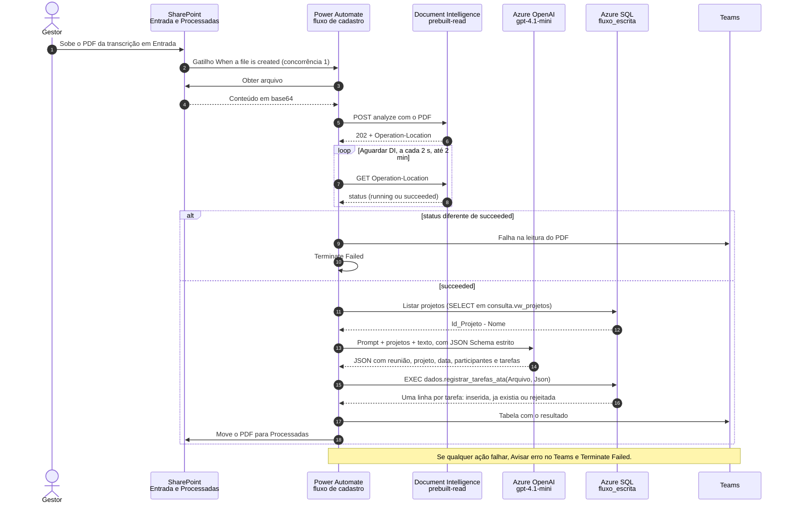
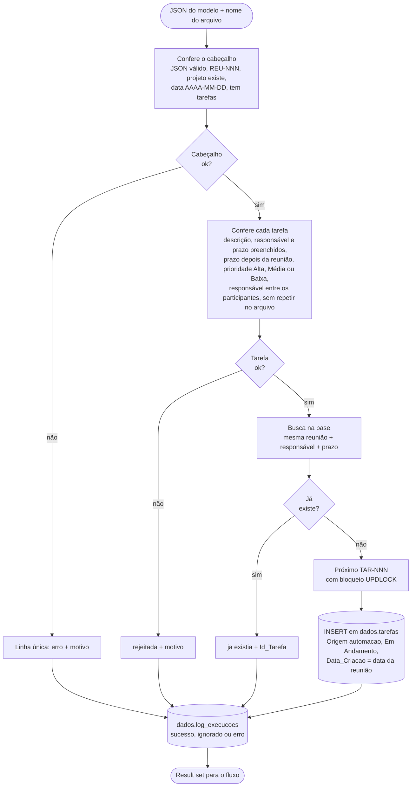
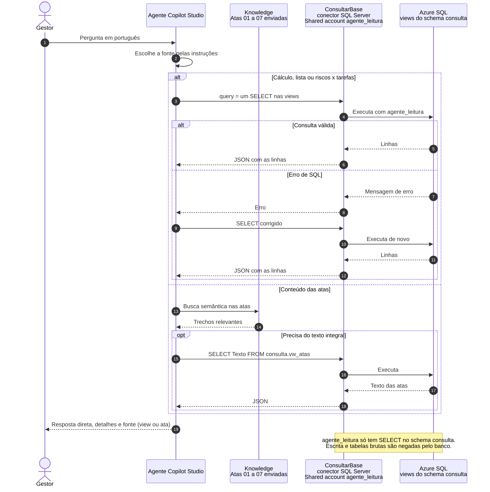
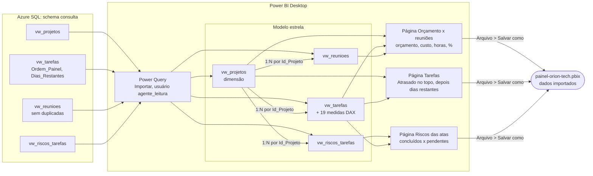
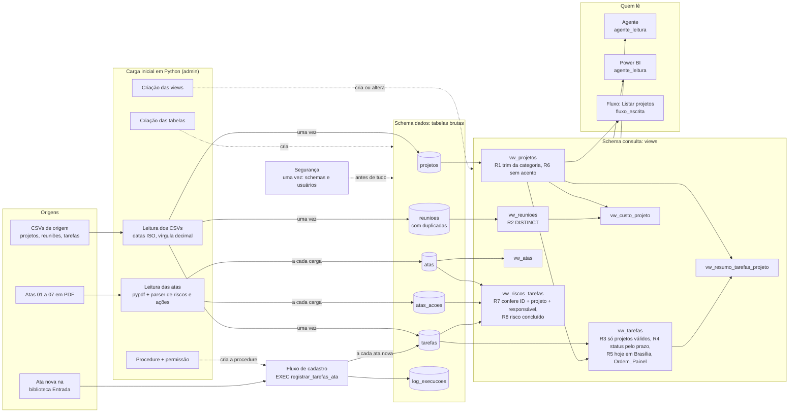

# Diagramas da solução

Quatro visões do funcionamento, em Mermaid.

## 1. Automação do cadastro de tarefas

Uma transcrição nova cai na biblioteca Entrada; o fluxo extrai o texto e as tarefas e entrega o JSON para a procedure, que valida, evita duplicatas, gera os IDs e grava.

### 1a. Caminho entre os sistemas

### 1b. O que a procedure decide

Rodar o mesmo PDF de novo devolve as tarefas como "ja existia": a deduplicação está na procedure e num índice único filtrado (`Origem = 'automacao'`).

## 2. O agente fazendo uma consulta

O agente decide, a cada pergunta, se consulta a base (cálculo, listas, riscos x tarefas), o texto das atas ou os dois. A base só é acessada por SELECT nas views, com um usuário que só tem leitura.

Exemplos de consulta que o agente gera:

| Pergunta | View consultada |
| --- | --- |
| 1. Top 3 de Desenvolvimento e IA com mais atrasadas | `vw_resumo_tarefas_projeto` |
| 2. Custo de reuniões do Alpha e % do orçamento | `vw_custo_projeto` |
| 3. Tarefas Alta da Beatriz por prazo | `vw_tarefas` |
| 4. Motivo técnico e fornecedor no Orion | Knowledge (Ata_01) ou `vw_atas` |
| 5. Riscos críticos concluídos e pendentes | `vw_riscos_tarefas` |

## 3. Painel de acompanhamento

O painel importa as mesmas views que o agente usa: os números batem entre os dois.

Não existe relação por `Id_Reuniao`: na base, ele aponta para reuniões de outro projeto em 79 das 115 tarefas (armadilha 7).
Depois de processar uma transcrição nova, **Página Inicial > Atualizar** traz as tarefas novas.

## 4. Como as tabelas são alimentadas e como as views funcionam

As tabelas de `dados` guardam o dado como veio (só com conversão de formato). As views de `consulta` não guardam dados: são consultas salvas, calculadas a cada leitura, com as regras de limpeza.

| Tabela | Quem alimenta | Quando |
| --- | --- | --- |
| `dados.projetos`, `dados.reunioes` | Carga dos CSVs | Uma vez |
| `dados.tarefas` | Carga dos CSVs + fluxo de cadastro | Uma vez + a cada ata nova |
| `dados.atas`, `dados.atas_acoes` | Carga lendo as Atas 01 a 07 | A cada execução da carga |
| `dados.log_execucoes` | Carga e procedure | A cada execução |
